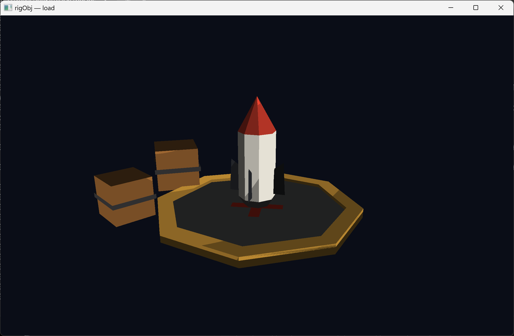

# rigObj



Wavefront **OBJ** load/save for [rigComponent](https://github.com/rigkid/rigComponent) `CMesh`, via [tinyobjloader](https://github.com/tinyobjloader/tinyobjloader). Code / IO only - no systems.

## API

```cpp
#include "ObjIO.h"

rigkit::ecs::CMesh mesh;
auto r = rig::obj::load("model.obj", mesh);
auto e = rig::obj::makeMeshFromFile(ecs, "model.obj", rig::fill(1,1,1), "thing");
rig::obj::save("out.obj", mesh);
```

Keeps authored vertices and faces. Tessellates n-gons to triangle `indices` for present. Fills `texcoords` and material `faceColors` (MTL diffuse) when present. Preferences section `rigObj.render` (Apply MTL Colors) when the pack is registered.

## Example

[examples/load](examples/load/) - Stanford bunny (with MTL) loads into `CMesh`, then presents under rigRender3D. Mouse orbit / pan / dolly; F to frame; Ctrl+R reloads the OBJ. Host Show FPS enables the corner readout.

```bash
cmake -S examples/load -B examples/load/build
cmake --build examples/load/build --target load
```

[API/docs](https://rigkid.github.io/rigObj/)
