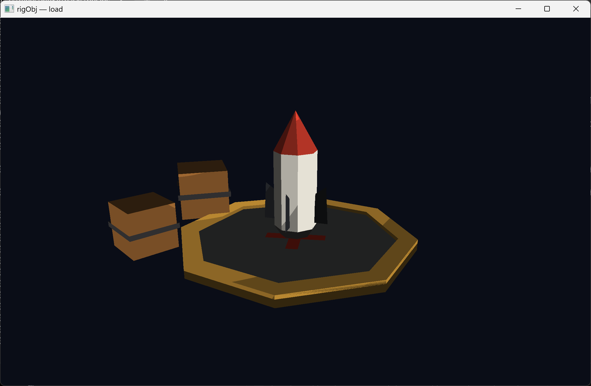

# load



Loads a small landing-pad scene from Wavefront OBJ (+ MTL diffuse to `CMesh::faceColors`), presents with rigRender3D.

Meshes in `data/`: `rocket.obj`, `pad.obj`, `crate.obj` 

```bash
cmake -S . -B build
cmake --build build --target load
./build/bin/load/load
```
